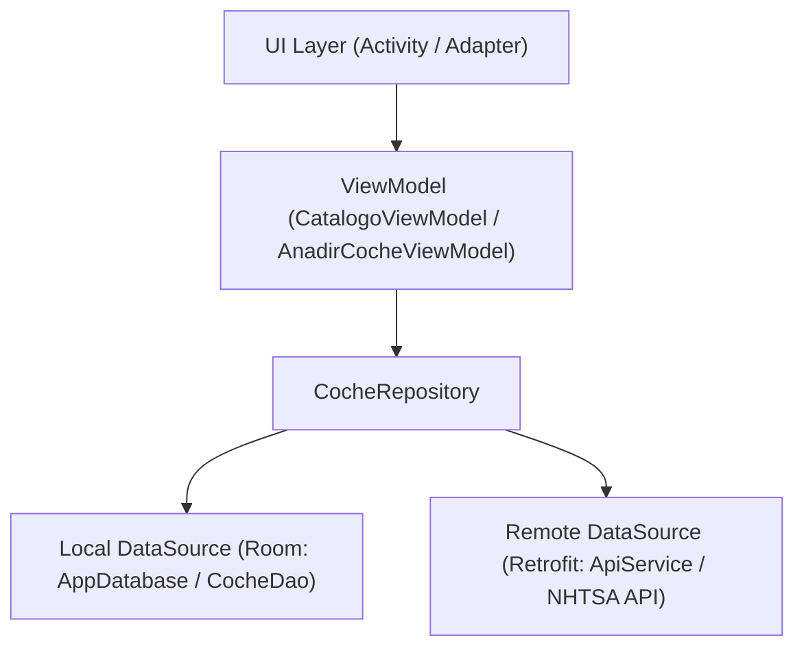

# Plan de Implementación - Proyecto V2: Concesionario Conectado a Internet

Evolución de la aplicación **Concesionario** hacia la **Versión 2**, cumpliendo con la especificación del documento `Proyecto_V2_App_conectada_a_Internet.pdf`. La nueva versión integrará datos de vehículos en tiempo real mediante una API REST pública gratuita, almacenamiento en caché local con Room para funcionamiento offline, carga de imágenes con Glide y arquitectura limpia **MVVM (ViewModel + Repository)**.

---

## 1. Propuesta de API REST y Justificación

- **API Seleccionada:** **NHTSA VPIC Vehicle API** (`https://vpic.nhtsa.dot.gov/api/`)
- **Justificación:** Es una API pública oficial del Departamento de Transporte de EE. UU. dedicada al sector automotriz. Es 100% gratuita, no requiere registro ni clave API (API Key), devuelve datos en JSON y ofrece información real de fabricantes, marcas y modelos de coches a nivel mundial.
- **Endpoints Clave:**
  - Obtener modelos por marca: `https://vpic.nhtsa.dot.gov/api/vehicles/getmodelsformake/{marca}?format=json`
  - Obtener listado de marcas populares: `https://vpic.nhtsa.dot.gov/api/vehicles/GetMakesForVehicleType/car?format=json`
- **Carga de Imágenes Remotas:** Integración de **Glide** con soporte para imágenes promocionales/ilustrativas según la marca/modelo del vehículo o la URL devuelta.

---

## 2. Requisitos Técnicos y Dependencias

Se añadirán las siguientes librerías al proyecto (`build.gradle.kts` y `libs.versions.toml`):

1. **Permisos:** `<uses-permission android:name="android.permission.INTERNET" />` y `<uses-permission android:name="android.permission.ACCESS_NETWORK_STATE" />`
2. **Retrofit 2 + Converter Gson:** Para la comunicación HTTP/REST asíncrona.
3. **Glide:** Para la carga y caché eficiente de imágenes desde URL.
4. **Lifecycle ViewModel & LiveData / StateFlow:** Para desacoplar la lógica de presentación del ciclo de vida de las Activities.

---

## 3. Arquitectura Propuesta (MVVM + Repository)

### Capas:
- **Remote Data Source:** `ApiService.kt`, `RetrofitClient.kt`, `NhtsaResponse.kt` (Modelos DTO).
- **Local Data Source:** `AppDatabase.kt`, `CocheDao.kt`, `Coche.kt` (Room Entity ampliada con indicador `esOnline` / `origen`).
- **Repository:** `CocheRepository.kt` gestiona la estrategia de red/caché:
  - Si hay conexión a Internet, consulta la API REST y guarda/actualiza los modelos en Room.
  - Si no hay conexión (offline), sirve los datos previamente cacheados en Room sin cerrar la app.
- **Presentation Layer:** `UiState` (Loading, Success, Error, Offline), `ViewModel`s para manejar estados de pantalla.

---

## 4. Mejora Propia (Hito 3)

**Buscador Online de Modelos de Fabricantes e Importador al Garaje Local con Cámara y GPS:**
- El usuario podrá buscar modelos de coches reales en tiempo real por marca (Ej: Seat, Toyota, BMW, Audi, Ford, etc.).
- Desde el catálogo online, con un solo toque podrá **"Importar a mi concesionario"**, lo que abrirá la pantalla de añadir vehículo autocompletando la marca y el modelo obtenidos online, permitiéndole tomar una fotografía real con la cámara y etiquetar la ubicación GPS del concesionario.

---

## 5. Cambios Propuestos por Componente / Archivo

---

### Configuración del Proyecto y Dependencias

#### [MODIFY] [libs.versions.toml](file:///E:/workspace/2DAM/PMDMO/proyectoLibre/gradle/libs.versions.toml)
- Añadir versiones y definiciones para Retrofit, Gson Converter y Glide.

#### [MODIFY] [build.gradle.kts](file:///E:/workspace/2DAM/PMDMO/proyectoLibre/app/build.gradle.kts)
- Agregar dependencias de Retrofit, Gson y Glide.

#### [MODIFY] [AndroidManifest.xml](file:///E:/workspace/2DAM/PMDMO/proyectoLibre/app/src/main/AndroidManifest.xml)
- Declarar permisos de `INTERNET` y `ACCESS_NETWORK_STATE`.

---

### Capa de Datos Remota (Retrofit API)

#### [NEW] [NhtsaModels.kt](file:///E:/workspace/2DAM/PMDMO/proyectoLibre/app/src/main/java/com/example/aplicaciondam2/data/remote/NhtsaModels.kt)
- Clases de datos Kotlin para mapear las respuestas JSON de la API (`NhtsaModelResponse`, `NhtsaModelDto`).

#### [NEW] [ApiService.kt](file:///E:/workspace/2DAM/PMDMO/proyectoLibre/app/src/main/java/com/example/aplicaciondam2/data/remote/ApiService.kt)
- Interfaz Retrofit con funciones `suspend` para la consulta de modelos por marca.

#### [NEW] [RetrofitClient.kt](file:///E:/workspace/2DAM/PMDMO/proyectoLibre/app/src/main/java/com/example/aplicaciondam2/data/remote/RetrofitClient.kt)
- Singleton que construye y provee la instancia de Retrofit apuntando a `https://vpic.nhtsa.dot.gov/api/`.

---

### Capa de Datos Local y Repositorio

#### [MODIFY] [Coche.kt](file:///E:/workspace/2DAM/PMDMO/proyectoLibre/app/src/main/java/com/example/aplicaciondam2/Coche.kt)
- Añadir campo `esOnline: Boolean = false` y `imageUrl: String? = null` para soportar modelos remotos/cacheados.

#### [MODIFY] [CocheDao.kt](file:///E:/workspace/2DAM/PMDMO/proyectoLibre/app/src/main/java/com/example/aplicaciondam2/CocheDao.kt)
- Añadir métodos `@Insert(onConflict = OnConflictStrategy.REPLACE)` para guardar la caché online y consultas de filtro por marca.

#### [MODIFY] [CocheRepository.kt](file:///E:/workspace/2DAM/PMDMO/proyectoLibre/app/src/main/java/com/example/aplicaciondam2/CocheRepository.kt)
- Implementar la lógica de repositorio unificado:
  - `obtenerCochesOnlineOEnCache(marca: String)`: Llama a la API, si tiene éxito guarda en Room y devuelve los datos; si ocurre un error de red o no hay conexión, recupera los datos cacheados de Room.
  - `insertarCoche(coche: Coche)`, `borrarCoche(coche: Coche)`.

---

### Capa de Presentación (ViewModel & UI)

#### [NEW] [CatalogoViewModel.kt](file:///E:/workspace/2DAM/PMDMO/proyectoLibre/app/src/main/java/com/example/aplicaciondam2/ui/CatalogoViewModel.kt)
- Administra el estado de la UI (`UiState`: `Cargando`, `Exito`, `Error`, `SinConexion`) usando `StateFlow` o `LiveData`.

#### [MODIFY] [CatalogoActivity.kt](file:///E:/workspace/2DAM/PMDMO/proyectoLibre/app/src/main/java/com/example/aplicaciondam2/CatalogoActivity.kt)
- Integrar `CatalogoViewModel`.
- Añadir selector de filtro de marcas (Seat, Toyota, Ford, BMW, Volkswagen, etc.) y pestaña/modo para alternar entre "Inventario Local" y "Modelos Online".
- Mostrar indicador de carga (`ProgressBar`), banner/Toast de error o aviso sin conexión.

#### [MODIFY] [CocheAdapter.kt](file:///E:/workspace/2DAM/PMDMO/proyectoLibre/app/src/main/java/com/example/aplicaciondam2/CocheAdapter.kt)
- Usar **Glide** para cargar imágenes de URL (`imageUrl`) manteniendo la compatibilidad con fotos locales (`fotoPath`) o recursos estáticos (`imagenResId`).

#### [MODIFY] [activity_catalogo.xml](file:///E:/workspace/2DAM/PMDMO/proyectoLibre/app/src/main/res/layout/activity_catalogo.xml)
- Incluir `ProgressBar`, buscador/spinner de marcas y vista de aviso de error/modo offline.

---

## 6. Plan de Verificación

### Pruebas Automatizadas
- Compilación del proyecto (`gradle_build("app:assembleDebug")`).
- Pruebas unitarias de parsing de datos JSON y mapeo de la API.

### Pruebas Manuales
1. **Verificación Online (Hito 1 & 2):**
   - Abrir el catálogo con conexión a Internet activa.
   - Filtrar por marcas (ej: Seat, Toyota, Ford) y verificar que se muestra la lista proveniente de la API NHTSA con estado de carga (`ProgressBar`).
   - Pulsar un modelo para abrir el detalle y comprobar la carga de la imagen vía Glide.
2. **Verificación Offline (Modo Sin Conversión / Modo Avión):**
   - Activar el Modo Avión en el dispositivo/emulador.
   - Reabrir la app y consultar la lista. Verificar que la app no colapsa, muestra un aviso de "Modo Sin Conexión" y carga correctamente los modelos cacheados en Room.
3. **Verificación de Mejora Propia (Hito 3):**
   - Seleccionar un coche del catálogo online y pulsar "Importar a mi concesionario".
   - Verificar que se abre el formulario autocompletando marca y modelo.
   - Adjuntar foto con la cámara y capturar la posición GPS actual. Guardar y verificar que aparece en el inventario local.
