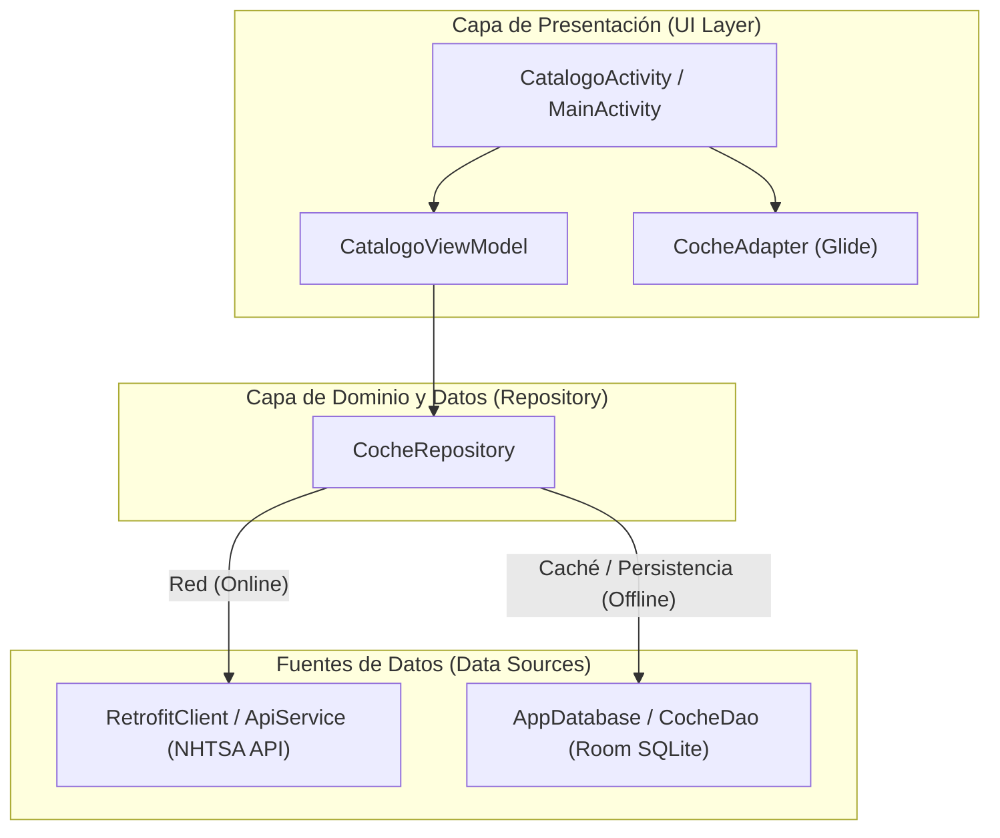

# Documentación del Proyecto V2

**Aplicación:** Concesionario de Coches de Segunda Mano (`aplicacionDAM2`)  
**Módulo:** Programación de Dispositivos Móviles (PMDMO) - 2º DAM  
**Versión:** 2.0 (Aplicación Conectada a Internet)  

---

## 1. Justificación y Documentación de la API REST

### 1.1 Ficha Técnica de la API
- **Nombre de la API:** NHTSA VPIC Vehicle API (*National Highway Traffic Safety Administration*)
- **URL Base:** `https://vpic.nhtsa.dot.gov/api/`
- **Documentación Oficial:** [https://vpic.nhtsa.dot.gov/api/](https://vpic.nhtsa.dot.gov/api/)
- **Formato de Respuesta:** JSON (JavaScript Object Notation)
- **Autenticación:** Ninguna (API pública, 100% gratuita y sin necesidad de API Key o registro)

### 1.2 Justificación de la Elección
Para la Versión 2 de la aplicación se requería integrar una API pública REST que estuviera estrechamente vinculada a la temática de la app (compraventa/gestión de vehículos de concesionario). 

Se eligió la API de **NHTSA VPIC** por los siguientes motivos principales:
1. **Acceso Gratuito e Ilimitado:** No requiere claves privadas ni registro de usuario, lo que evita fallos de cuota o bloqueos durante la evaluación y demostración.
2. **Relevancia y Datos Reales:** Proporciona un catálogo de datos oficial y actualizado de fabricantes globales (como Seat, Toyota, Ford, BMW, Volkswagen, Honda, Audi, Nissan, etc.) y sus modelos.
3. **Compatibilidad Estructurada:** Los datos devueltos en JSON tienen una estructura clara que permite un fácil mapeo a objetos Kotlin utilizando **Retrofit 2** y **Gson**.

### 1.3 Endpoint Utilizado y Estructura JSON
El endpoint integrado en la aplicación es:
```http
GET https://vpic.nhtsa.dot.gov/api/vehicles/getmodelsformake/{marca}?format=json
```

**Ejemplo de respuesta JSON obtenida:**
```json
{
  "Count": 20,
  "Message": "Response returned successfully",
  "SearchCriteria": "Make:SEAT",
  "Results": [
    {
      "Make_ID": 474,
      "Make_Name": "SEAT",
      "Model_ID": 1864,
      "Model_Name": "Leon"
    },
    {
      "Make_ID": 474,
      "Make_Name": "SEAT",
      "Model_ID": 1865,
      "Model_Name": "Ibiza"
    }
  ]
}
```

---

## 2. Estructura del Proyecto y Arquitectura

La aplicación está diseñada siguiendo los principios de la **Clean Architecture** en Android y el patrón recomendado por Google **MVVM (Model-View-ViewModel)** combinado con el patrón **Repository**.

### 2.1 Diagrama de Arquitectura de Datos



---

### 2.2 Organización de Paquetes y Archivos

El proyecto está estructurado dentro del paquete `com.example.aplicaciondam2` de la siguiente manera:

```text
com.example.aplicaciondam2
│
├── data/
│   └── remote/
│       ├── ApiService.kt        # Interfaz Retrofit con peticiones GET
│       ├── NhtsaModels.kt       # DTOs de datos JSON (NhtsaModelResponse, NhtsaModelDto)
│       └── RetrofitClient.kt    # Singleton del cliente HTTP con Retrofit + Gson
│
├── ui/
│   ├── CatalogoViewModel.kt     # ViewModel de la pantalla de catálogo y CatalogoUiState
│   └── theme/                   # Colores, Tipografías y Temas de la app
│
├── AppDatabase.kt               # Clase abstracta de Room (Database Callback + Migración)
├── Coche.kt                     # Entidad principal de Room (tabla 'coches')
├── CocheDao.kt                  # Data Access Object con consultas SQLite
├── CocheRepository.kt           # Repositorio unificado (Estrategia Red + Caché Offline)
├── Fotos.kt                     # Clase de utilidad para guardar/cargar imágenes locales y FileProvider
│
├── MainActivity.kt              # Pantalla principal (Dashboard y contador de coches)
├── CatalogoActivity.kt          # Pantalla de catálogo (Pestañas Local/Online, Spinner y RecyclerView)
├── AnadirCocheActivity.kt       # Formulario para añadir/importar coche (Cámara + Galería + GPS)
├── DetalleCocheActivity.kt      # Vista detallada del coche seleccionado (Glide / Foto local)
└── CocheAdapter.kt              # Adaptador del RecyclerView con soporte para imágenes remotas (Glide)
```

---

## 3. Funcionamiento Técnico y Características Clave

### 3.1 Comunicación de Red (Retrofit 2 + Gson + Corrutinas)
- Las llamadas a la API se ejecutan en segundo plano utilizando **Corrutinas Kotlin** (`Dispatchers.IO`) para evitar bloqueos en el hilo de interfaz de usuario (UI Thread).
- **Gson** convierte automáticamente el JSON devuelto por la API NHTSA en objetos fuertemente tipados (`NhtsaModelDto`).

### 3.2 Carga Eficiente de Imágenes (Glide)
- La app integra la librería **Glide** para descargar e insertar imágenes dinámicas desde URLs.
- Si el vehículo dispone de `imageUrl`, Glide gestiona automáticamente la caché en memoria RAM y disco, mostrando placeholders (`ic_coche`) en caso de retardo o fallo de carga.

### 3.3 Almacenamiento Local y Funcionamiento Sin Conexión (Room Cache)
- **Persistencia en Room:** La entidad `Coche` almacena tanto vehículos creados manualmente por el usuario como modelos consultados desde la API (`esOnline = true`).
- **Estrategia Modo Sin Conexión (Offline):**
  - Cuando el usuario realiza una búsqueda online, `CocheRepository` consulta la API. Si la petición es exitosa, se guardan o actualizan los modelos devueltos en la base de datos Room (`cocheDao.insertarLista(...)`).
  - Si la conexión a Internet falla o el dispositivo se encuentra en **Modo Avión**, el repositorio captura la excepción y recupera al instante los modelos guardados previamente en Room (`cocheDao.obtenerPorMarca(...)`). Esto garantiza que la app nunca sufra un cierre inesperado por fallos de red.

### 3.4 Integración con Hardware (Cámara y GPS)
- **Cámara y Galería:** Implementado mediante `ActivityResultContracts.TakePicture()` y `PickVisualMedia()`. Las fotos tomadas se guardan de forma segura en el almacenamiento interno mediante `FileProvider`.
- **Ubicación GPS:** Integración con Google Play Services (`FusedLocationProviderClient`) con alta precisión (`PRIORITY_HIGH_ACCURACY`) para obtener la latitud y longitud actuales del concesionario.

### 3.5 Mejora Propia (Importador al Concesionario Local)
- Cada coche mostrado en el **Catálogo API Online** dispone de un botón de acción rápida **"Importar al concesionario"** (`+`). Al pulsarlo:
  1. Se abre la pantalla `AnadirCocheActivity` autocompletando la **Marca** y el **Modelo** seleccionados de la API.
  2. Permite al usuario personalizar el precio, año y descripción.
  3. Permite adjuntar una **fotografía real tomada con la cámara** y capturar las **coordenadas GPS** exactas de la ubicación antes de registrarlo en el inventario local.

---

## 4. Resumen de Librerías y Tecnologías Empleadas

| Librería / Tecnología | Función en el Proyecto |
| :--- | :--- |
| **Retrofit 2 (`2.11.0`)** | Cliente HTTP REST para consultas asíncronas a la API NHTSA. |
| **Gson Converter (`2.11.0`)** | Parseo automático de respuestas JSON a clases DTO Kotlin. |
| **Glide (`4.16.0`)** | Carga y gestión de caché de imágenes desde URLs remotas. |
| **Room Database (`2.8.5`)** | Base de datos SQLite local para almacenamiento y caché offline. |
| **KSP (`2.3.12`)** | Procesador de anotaciones rápido para Room y Glide. |
| **Play Services Location (`21.3.0`)** | Cliente `FusedLocationProviderClient` para posicionamiento GPS. |
| **Kotlin Coroutines & Lifecycle** | Ejecución de tareas asíncronas y ViewModel alineado al ciclo de vida. |
| **Material Components & AppCompat** | Componentes visuales (`Spinner`, `RecyclerView`, `ProgressBar`, `AlertDialog`). |
